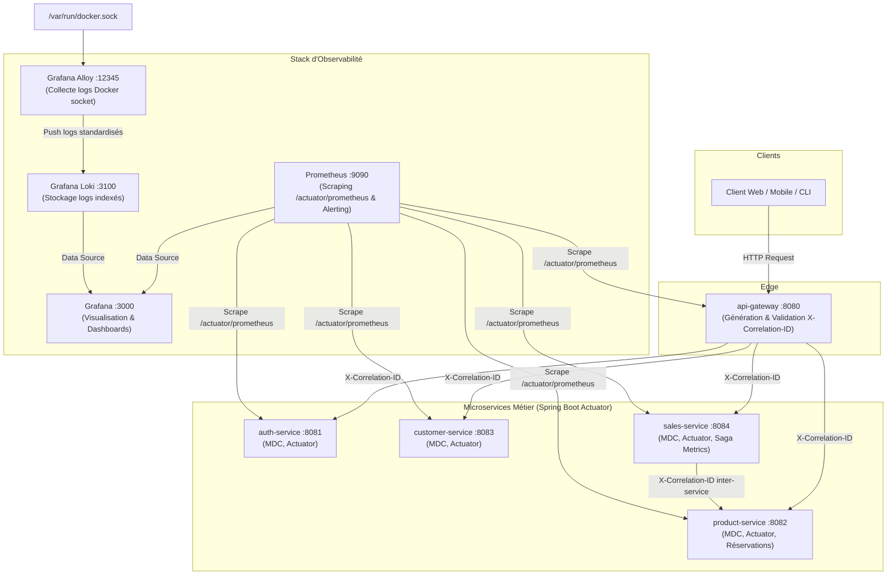

# AI Business Platform

Plateforme microservices modulaire pour la gestion commerciale et d'entreprise, développée avec **Spring Boot 3.4 (Spring Cloud 2024)**, **Java 21**, **PostgreSQL 16**, **Redis 7**, et orchestrée avec **Docker Compose**.

---

## 1. Architecture & Services

La plateforme est articulée autour des microservices suivants :

| Service | Port Interne | Port Externe | Description |
| :--- | :--- | :--- | :--- |
| **API Gateway** | `8080` | `8080` | Point d'entrée unique (Spring Cloud Gateway WebFlux), routage, corrélation distribuée, CORS |
| **Auth Service** | `8081` | *Interne* | Gestion des comptes utilisateurs et émission des tokens JWT HMAC-SHA256 |
| **Customer Service** | `8083` | *Interne* | Gestion de la relation client (CRM) et coordonnées des entreprises |
| **Product Service** | `8082` | *Interne* | Catalogue de produits, inventaire et **réservations atomiques de stock** |
| **Sales Service** | `8084` | *Interne* | Commandes clients, recalcul serveur, **idempotence** et **Saga compensatoire** |
| **Analytics Service** | `8085` | *Interne* | Décisionnel, calcul des KPIs certifiés, tendances et alertes de stock faible |
| **PostgreSQL** | `5432` | `5433` | Base relationnelle multi-bases (`auth_db`, `customer_db`, `product_db`, `sales_db`, `analytics_db`) |
| **Redis** | `6379` | `6379` | Cache distribué et sessions |
| **Prometheus** | `9090` | `9090` | Collecteur de métriques Actuator & TSDB, évaluation des alertes |
| **Grafana** | `3000` | `3000` | Tableaux de bord unifiés (Platform, Services, Saga Reliability, Stock Reconciliation) |
| **Grafana Loki** | `3100` | `3100` | Moteur d'indexation et agrégation de logs des conteneurs |
| **Grafana Alloy** | `12345` | `12345` | Collecteur de logs conteneurs via Docker socket et relabellisation |
| **Frontend (React)** | `5173` | `5173` | Interface utilisateur web (React 18, TypeScript, Tailwind, TanStack Query) |

> **Sécurité réseau :** Seuls les services **API Gateway** (`8080`), **Grafana** (`3000`), **Prometheus** (`9090`), **Loki** (`3100`) et **Alloy** (`12345`) exposent des ports de consultation sur l'hôte en environnement local. Les microservices métier communiquent de manière isolée via le réseau interne Docker Compose par leurs noms de service DNS (`http://auth-service:8081`, `http://product-service:8082`, etc.).

---

## 2. Prérequis

- **Docker** Engine 24+ et **Docker Compose** v2.20+
- **Java 21** & **Maven 3.9+** (en cas de développement backend / tests locaux hors conteneur)
- **Node.js 20+** & **npm 10+** (pour l'exécution et le développement du frontend React)

---

## 3. Configuration de l'Environnement

Un fichier modèle `.env.example` est fourni à la racine du projet. Créez votre fichier local `.env` :

```bash
cp .env.example .env
```

Vérifiez les variables d'environnement principales dans `.env` :
- `POSTGRES_USER` : Utilisateur de la base de données (défaut: `ai_platform`).
- `POSTGRES_PASSWORD` : Mot de passe sécurisé.
- `JWT_SECRET` : Clé secrète partagée HMAC-SHA256 (encodée en Base64, min. 256 bits).
- `GATEWAY_PORT` : Port d'écoute public de l'API Gateway (défaut: `8080`).

---

## 4. Démarrage de la Plateforme (Docker Compose)

### Construire et démarrer tous les services :

```bash
docker compose up -d --build
```

### Ordre de démarrage et sondes de préparation (Readiness Checks) :
Le fichier `docker-compose.yml` configure un ordonnancement strict basé sur les healthchecks :
1. **PostgreSQL** s'initialise et devient `healthy` via `pg_isready`.
2. **Auth Service**, **Customer Service** et **Product Service** démarrent simultanément et exécutent leurs migrations Flyway.
3. **Sales Service** démarre une fois que PostgreSQL, Product Service et Customer Service sont prêts (`healthy`).
4. **API Gateway** démarre une fois que tous les services cibles sont opérationnels.

---

## 5. Surveillance & Santé des Services

### Vérifier le statut de tous les conteneurs :

```bash
docker compose ps
```

Tous les conteneurs doivent afficher le statut `(healthy)`.

### Consulter les logs en temps réel :

```bash
# Logs de l'ensemble de la plateforme
docker compose logs -f

# Logs d'un service spécifique
docker compose logs -f api-gateway
docker compose logs -f sales-service
docker compose logs -f product-service
```

### Vérifier la santé via l'API Gateway :

```bash
curl http://localhost:8080/actuator/health
```

---

## 5. Démarrage du Frontend (React 18 & TypeScript)

Le frontend se trouve dans le répertoire `frontend/` et communique avec la plateforme via la passerelle API (`http://localhost:8080`).

### Installation et exécution en mode développement :

```bash
cd frontend
cp .env.example .env
npm install
npm run dev
```

L'application est accessible à l'adresse : **`http://localhost:5173`**

### Tests unitaires et vérification des types :

```bash
npm test          # Exécution des tests unitaires Vitest
npm run typecheck  # Contrôle des types TypeScript
npm run build      # Compilation de production
```

Pour plus de détails, consultez la documentation dédiée : [frontend/README.md](file:///home/rida/Projects/ai-business-platform/frontend/README.md).

---

## 6. Guide de Test Rapide (Smoke Test & RBAC)

Toutes les requêtes s'effectuent à travers l'**API Gateway** (`http://localhost:8080`) :

### A. Vérifier le rejet d'un accès anonyme (HTTP 401 Unauthorized)
```bash
curl -i -s "http://localhost:8080/api/products"
```
*Réponse attendue : `HTTP/1.1 401 Unauthorized` avec le corps standardisé `{"error":"UNAUTHORIZED","message":"..."}`.*

### B. Inscription d'un utilisateur standard (Rôle `USER`)
```bash
USER_TOKEN=$(curl -s -X POST "http://localhost:8080/api/auth/register" \
  -H "Content-Type: application/json" \
  -d '{"username":"dev_user","email":"dev@example.com","password":"Password123!"}' \
  | jq -r '.token')
echo "User Token: $USER_TOKEN"
```

### C. Vérifier la protection d'un endpoint privilégié (HTTP 403 Forbidden)
Une tentative de création de produit dans le catalogue par un compte utilisateur standard `USER` est bloquée :
```bash
curl -i -s -X POST "http://localhost:8080/api/products" \
  -H "Content-Type: application/json" \
  -H "Authorization: Bearer $USER_TOKEN" \
  -d '{"name":"ThinkPad X1","description":"Ultrabook","price":1500.00,"stockQuantity":10,"category":"PC"}'
```
*Réponse attendue : `HTTP/1.1 403 Forbidden` avec `{"error":"FORBIDDEN","message":"Access Denied: insufficient permissions"}`.*

### D. Connexion d'un compte Administrateur (Rôle `ADMIN`)
En utilisant les identifiants administrateur amorcés au démarrage (`INITIAL_ADMIN_*` configuré dans `.env` / `docker-compose.yml`) :
```bash
ADMIN_TOKEN=$(curl -s -X POST "http://localhost:8080/api/auth/login" \
  -H "Content-Type: application/json" \
  -d '{"email":"admin@example.com","password":"AdminSecurePassword123!"}' \
  | jq -r '.token')
echo "Admin Token: $ADMIN_TOKEN"
```

### E. Création d'un produit par l'administrateur (Succès HTTP 201)
```bash
PRODUCT_ID=$(curl -s -X POST "http://localhost:8080/api/products" \
  -H "Content-Type: application/json" \
  -H "Authorization: Bearer $ADMIN_TOKEN" \
  -d '{"name":"ThinkPad X1","description":"Ultrabook","price":1500.00,"stockQuantity":10,"category":"PC"}' \
  | jq -r '.id')
echo "Product ID: $PRODUCT_ID"
```

### F. Opérations métier par l'utilisateur standard (Client, Vente & Réservation)
L'utilisateur standard `USER` peut créer un client, consulter le catalogue et passer commande :
```bash
# 1. Créer un client
CUSTOMER_ID=$(curl -s -X POST "http://localhost:8080/api/customers" \
  -H "Content-Type: application/json" \
  -H "Authorization: Bearer $USER_TOKEN" \
  -d '{"firstName":"Jean","lastName":"Dupont","email":"jean@example.com","company":"Acme Corp"}' \
  | jq -r '.id')

# 2. Créer une vente de 2 unités avec clé d'idempotence
SALE_ID=$(curl -s -X POST "http://localhost:8080/api/sales" \
  -H "Content-Type: application/json" \
  -H "Authorization: Bearer $USER_TOKEN" \
  -H "Idempotency-Key: CMD-DEV-001" \
  -d "{\"customerId\":$CUSTOMER_ID,\"items\":[{\"productId\":$PRODUCT_ID,\"quantity\":2}]}" \
  | jq -r '.id')
```
*Le jeton Bearer de l'utilisateur est propagé de manière sécurisée de `sales-service` vers `product-service` et `customer-service` ; le stock passe de 10 à 8 de façon atomique.*

### G. Vérifier le rejet d'une survente (Overselling)
```bash
# Tenter de réserver 50 unités alors que 8 sont disponibles
curl -s -X POST "http://localhost:8080/api/sales" \
  -H "Content-Type: application/json" \
  -H "Authorization: Bearer $USER_TOKEN" \
  -d "{\"customerId\":$CUSTOMER_ID,\"items\":[{\"productId\":$PRODUCT_ID,\"quantity\":50}]}"
```
*Réponse attendue : `HTTP/1.1 409 Conflict` (Stock insuffisant).*

### H. Annulation de commande et compensation Saga
```bash
curl -s -X POST "http://localhost:8080/api/sales/$SALE_ID/cancel" \
  -H "Authorization: Bearer $USER_TOKEN"
```
*Le stock du produit est automatiquement restauré à 10 par la Saga compensatoire.*

---

## 7. Procédures de Réinitialisation & Nettoyage

### Arrêt standard (conservation des données) :
```bash
docker compose down
```
*Les volumes `postgres_data` et `redis_data` sont conservés intacts.*

### Réinitialisation complète pour environnement jetable :
Pour réinitialiser complètement la base de données et repartir d'un environnement propre :
```bash
docker compose down -v
```
*Au prochain `docker compose up -d`, le script `infrastructure/postgres/init-databases.sh` recréera automatiquement toutes les bases de données et Flyway réappliquera l'ensemble des migrations.*

---

## 8. Dépannage (Troubleshooting)

- **Erreur 401 Unauthorized systématique :**
  Vérifiez que la variable `JWT_SECRET` dans `.env` est strictement identique entre `auth-service` et les services ressources (`product-service`, `customer-service`, `sales-service`).
- **Erreur de connexion base de données au démarrage :**
  Assurez-vous que le conteneur PostgreSQL est sain (`docker compose ps postgres`). Si les bases n'existent pas, exécutez `infrastructure/postgres/init-databases.sh` ou réinitialisez le volume avec `docker compose down -v`.
- **Conflit de port sur l'hôte :**
  Si le port 8080 ou 5433 est déjà utilisé par une autre application locale, modifiez `GATEWAY_PORT` ou `POSTGRES_PORT` dans votre fichier `.env`.

---

## 9. Intégration Continue (CI/CD) & Assurance Qualité

Le pipeline GitHub Actions est configuré dans `.github/workflows/ci.yml`.

### Comportement du Workflow CI

Le workflow est déclenché sur :
- Tout **Pull Request** ciblant la branche `main`
- Tout **Push** sur `main`, `develop` et les branches de fonctionnalités `feature/**`

Il comprend 3 jobs distincts :

1. **`security-checks` (Qualité & Sécurité) :**
   - **Gitleaks (Vérification bloquante) :** Analyse l'historique Git et les fichiers de configuration à l'aide de `.gitleaks.toml` pour détecter et bloquer toute fuite de clés ou jetons réels.
   - **Trivy (Avertissement informationnel) :** Analyse les dépendances de chaque module Java pour détecter les vulnérabilités CVE critiques et élevées sans bloquer arbitrairement la livraison en cas de dépendance transitive sans correctif disponible.
2. **`maven-build-and-test` (Matrice Parallèle de Tests) :**
   - Provisionne un service de test PostgreSQL 16 éphémère.
   - Initialise les 5 bases de données (`auth_db`, `customer_db`, `product_db`, `sales_db`, `analytics_db`).
   - Exécute les tests Maven pour chaque microservice en parallèle via une matrice GitHub Actions (`auth-service`, `api-gateway`, `product-service`, `customer-service`, `sales-service`).
   - Archive les rapports de tests Surefire (`surefire-reports-*`) sous forme d'artefacts conservés 7 jours.
3. **`docker-compose-validate` (Validation Docker & Smoke Test) :**
   - Valide la syntaxe Compose via `docker compose config`.
   - Construit les 5 images Docker via leurs builds multi-étapes.
   - Démarre la stack complète en conditions réelles et attend la préparation (`healthy`) de tous les conteneurs.
   - Exécute un test de fumée (Smoke Test) de bout en bout à travers l'API Gateway : authentification, création client, création produit, réservation atomique, rejet d'une survente et compensation Saga lors d'une annulation.

### Exécuter les tests localement

Pour exécuter les tests d'un service spécifique :
```bash
mvn -f services/product-service/pom.xml test
```

Pour exécuter les tests de l'ensemble du monorepo :
```bash
for service in auth-service api-gateway product-service customer-service sales-service; do
  echo ">>> Exécution des tests pour : $service"
  mvn -B -f "services/$service/pom.xml" test
done
```

> **Note :** Les tests d'intégration nécessitent que le conteneur PostgreSQL soit actif sur le port `5433` (exécuter `docker compose up -d postgres`).

### Diagnostiquer un échec de job CI GitHub Actions

1. Accédez à l'onglet **Actions** sur GitHub : `https://github.com/RidaManfalouti/ai-business-platform/actions`.
2. Cliquez sur l'exécution en échec.
3. Repérez le job spécifique en erreur dans la matrice (ex: `Build & Test (sales-service)`).
4. Déroulez l'étape **Compile & Run Maven Tests** pour visualiser la stacktrace.
5. En bas de page du workflow, téléchargez l'artefact `surefire-reports-<service>` contenant les fichiers XML et TXT détaillés pour chaque test échoué.

### Reproduire et déboguer les builds Docker en local

Si une étape de build Docker échoue dans la CI :
```bash
# Valider la configuration Compose
docker compose --env-file .env.example config

# Reconstruire un service spécifique avec affichage verbeux
docker compose build --progress=plain <service-name>

# Exemple pour product-service :
docker compose build --progress=plain product-service
```

### Paramétrage recommandé de la protection de branche sur GitHub

> **Important :** La protection de branche doit être configurée dans les paramètres de votre dépôt GitHub (Settings > Branches) :

1. Définir une règle de protection de branche sur `main` :
   - Cocher **"Require a pull request before merging"** (1 approbation requise).
   - Cocher **"Require status checks to pass before merging"** :
     - Ajouter les statuts requis :
       - `Quality & Security Checks`
       - `Build & Test (auth-service)`
       - `Build & Test (api-gateway)`
       - `Build & Test (product-service)`
       - `Build & Test (customer-service)`
       - `Build & Test (sales-service)`
       - `Docker Compose Validation & Smoke Test`
   - Cocher **"Require branches to be up to date before merging"**.
   - Cocher **"Require linear history"** (évite les commits de merge désordonnés).
   - Interdire les suppressions et les pushs forcés (**"Do not allow force pushes"**).

---

## 10. Sécurité & Contrôle d'Accès Basé sur les Rôles (RBAC)

La plateforme met en œuvre un contrôle d'accès basé sur les rôles (**RBAC**) rigoureux, conforme aux exigences de sécurité d'entreprise et aux principes de moindre privilège et de défense en profondeur (*Defense in Depth*).

### 10.1. Modèle de Rôles

Le modèle est minimal, explicite et sécurisé :
- **`ROLE_USER`** : Rôle standard par défaut accordé à tout nouvel utilisateur lors de son inscription. Permet d'effectuer des opérations métier normales : gestion de son profil personnel, consultation du catalogue de produits, gestion des fiches clients (CRM) et passage de commandes de vente avec réservation atomique de stock.
- **`ROLE_ADMIN`** : Rôle à privilèges élevés. Requis pour les opérations administratives : gestion du catalogue produit (création, mise à jour, suppression de produits), suppression définitive de fiches clients, consultation de l'ensemble des utilisateurs et modification de leurs rôles.

#### Persistance et Intégrité en Base de Données
- Les rôles sont persistés dans la table `users` de la base `auth_db`.
- Une migration Flyway (`V1__create_users_table.sql`) garantit la rétrocompatibilité :
  - La colonne `role VARCHAR(20) NOT NULL DEFAULT 'USER'` est ajoutée de manière idempotente.
  - Tout utilisateur préexistant sans rôle se voit assigner `USER` (moindre privilège strict).
  - Une contrainte SQL `CHECK (role IN ('USER', 'ADMIN'))` empêche toute valeur incohérente en base.
- **Aucune confiance dans les entrées clientes** :
  - Le DTO d'enregistrement `RegisterRequest` n'expose aucun attribut `role`.
  - L'API Gateway filtre et supprime automatiquement tout en-tête d'autorité forgé par le client (`X-Role`, `X-Roles`, `X-User-Role`, `X-Authorities`) via `AuthorizationHeaderForwardingFilter`.
  - Chaque microservice valide la signature cryptographique du jeton JWT et en extrait les autorités indépendamment de la passerelle.

---

### 10.2. Matrice d'Autorisation

| Service | Méthode & Endpoint | Rôle Requis | Justification Métier |
| :--- | :--- | :--- | :--- |
| **auth-service** | `POST /api/auth/register` | Public (Anonyme) | Inscription d'un nouveau compte utilisateur |
| **auth-service** | `POST /api/auth/login` | Public (Anonyme) | Authentification et obtention du JWT |
| **auth-service** | `GET /api/users/me` | `USER`, `ADMIN` | Consultation du profil de l'utilisateur connecté |
| **auth-service** | `GET /api/users` | `ADMIN` | Supervision et audit de l'annuaire des utilisateurs |
| **auth-service** | `PATCH /api/users/{id}/role` | `ADMIN` | Promotion ou rétrogradation sécurisée d'un utilisateur |
| **product-service** | `GET /api/products` & `/api/products/**` | `USER`, `ADMIN` | Consultation du catalogue de produits |
| **product-service** | `POST /api/products` | `ADMIN` | Ajout d'une nouvelle référence au catalogue |
| **product-service** | `PUT /api/products/**` | `ADMIN` | Modification de fiche produit, prix ou inventaire |
| **product-service** | `DELETE /api/products/**` | `ADMIN` | Retrait d'une référence du catalogue |
| **product-service** | `POST /api/products/reservations` | `USER`, `ADMIN` | Réservation atomique de stock (workflow de vente) |
| **product-service** | `DELETE /api/products/reservations/**` | `USER`, `ADMIN` | Annulation et compensation de réservation de stock |
| **customer-service** | `GET /api/customers` & `/api/customers/**` | `USER`, `ADMIN` | Consultation des fiches clients |
| **customer-service** | `POST /api/customers` | `USER`, `ADMIN` | Création d'une nouvelle fiche client |
| **customer-service** | `PUT /api/customers/**` | `USER`, `ADMIN` | Mise à jour des informations client |
| **customer-service** | `DELETE /api/customers/**` | `ADMIN` | Suppression définitive d'une fiche client |
| **sales-service** | `GET /api/sales` & `/api/sales/**` | `USER`, `ADMIN` | Consultation de l'historique des commandes |
| **sales-service** | `POST /api/sales` | `USER`, `ADMIN` | Passation de commande avec réservation de stock |
| **sales-service** | `POST /api/sales/{id}/cancel` | `USER`, `ADMIN` | Annulation de commande et déclenchement de la Saga compensatoire |
| **analytics-service** | `GET /api/analytics/kpi` | `USER`, `ADMIN` | Consultation des KPIs consolidés (CA valide, volume, panier moyen) |
| **analytics-service** | `GET /api/analytics/trends` | `USER`, `ADMIN` | Analyse des tendances quotidiennes de ventes et revenus |
| **analytics-service** | `GET /api/analytics/top-products` | `USER`, `ADMIN` | Palmarès des articles les plus vendus sur commandes terminées |
| **analytics-service** | `GET /api/analytics/status-distribution` | `USER`, `ADMIN` | Répartition statistique des commandes par statut |
| **analytics-service** | `GET /api/analytics/low-stock` | `USER`, `ADMIN` | Alertes de réapprovisionnement et stocks faibles |
| **analytics-service** | `GET /api/analytics/dashboard` | `USER`, `ADMIN` | Synthèse décisionnelle consolidée pour le tableau de bord |

> **Propagation du Jeton Bearer :**
> Lors de la création ou de l'annulation d'une vente, `sales-service` relaie de manière transparente l'en-tête `Authorization: Bearer <token>` du client aux services `product-service` et `customer-service` via un intercepteur `RestClient`. Comme les endpoints de réservation et de vérification client autorisent `USER` et `ADMIN`, le flux commercial s'exécute sans friction avec l'identité de l'utilisateur initiateur.

---

### 10.3. Attribution et Modification Sécurisée des Rôles

1. **Amorçage sécurisé de l'administrateur initial (*Zero Hardcoding*) :**
   Aucun identifiant administrateur n'est codé en dur dans les sources. L'amorce initiale s'effectue au démarrage d'`auth-service` via des variables d'environnement :
   ```env
   INITIAL_ADMIN_ENABLED=true
   INITIAL_ADMIN_EMAIL=admin@example.com
   INITIAL_ADMIN_PASSWORD=VotreMotDePasseComplexe!
   INITIAL_ADMIN_USERNAME=admin
   ```
   La classe `AdminUserInitializer` vérifie si le compte existe : s'il est absent, il est créé avec `role = 'ADMIN'` ; s'il existe avec un autre rôle, il est promu. Si `INITIAL_ADMIN_ENABLED=false` (défaut de production), aucun compte n'est automatiquement créé.

2. **Délégation d'administration via l'API :**
   Un administrateur authentifié peut modifier le rôle de n'importe quel utilisateur :
   ```bash
   curl -s -X PATCH "http://localhost:8080/api/users/42/role" \
     -H "Authorization: Bearer $ADMIN_TOKEN" \
     -H "Content-Type: application/json" \
     -d '{"role":"ADMIN"}'
   ```
   Toute tentative d'appel à cet endpoint par un compte non-administrateur retourne un code `403 Forbidden`.

3. **Procédure d'urgence (*Break-glass*) :**
   En cas de perte d'accès administrateur en environnement opérationnel, une promotion directe peut être exécutée via SQL sécurisé dans `auth_db` :
   ```sql
   UPDATE users SET role = 'ADMIN' WHERE email = 'ops-lead@example.com';
   ```

---

### 10.4. Structure des Réclamations JWT (Claims)

Les jetons émis par `auth-service` utilisent le standard JSON Web Token (RFC 7519) signé en HMAC-SHA256 :

```json
{
  "sub": "user@example.com",
  "roles": [
    "ROLE_USER"
  ],
  "iat": 1729790000,
  "exp": 1729876400
}
```

#### Extraction et Normalisation des Autorités
Chaque microservice ressource (`product-service`, `customer-service`, `sales-service`) intègre la classe `JwtRoleConverter` :
- Extrait la liste de chaînes du claim `roles` (ou `authorities` en fallback).
- Préfixe automatiquement chaque élément par `ROLE_` s'il ne l'est pas déjà, assurant l'interopérabilité directe avec les expressions Spring Security `@PreAuthorize("hasRole('ADMIN')")` et `.hasRole("ADMIN")`.
- **Tolérance aux pannes et sécurité :** Si le claim `roles` est absent, vide ou d'un type inattendu, le convertisseur retourne une liste vide d'autorités sans lever d'exception, refusant l'accès aux routes protégées de manière sécurisée (*fail-safe*).

---

### 10.5. Test des Réponses HTTP 401 Unauthorized vs 403 Forbidden

Les microservices et la passerelle renvoient des charges utiles JSON standardisées :

#### HTTP 401 Unauthorized
Renvoyé lorsque le client n'est pas authentifié :
- Jeton `Authorization` manquant
- Jeton mal formé ou signature altérée
- Jeton expiré

```json
{
  "error": "UNAUTHORIZED",
  "message": "Full authentication is required to access this resource"
}
```

*Exemple de commande pour tester le 401 :*
```bash
curl -i -X GET "http://localhost:8080/api/products"
# HTTP/1.1 401 Unauthorized
```

#### HTTP 403 Forbidden
Renvoyé lorsque le client est correctement authentifié mais ne détient pas l'autorité requise pour l'opération :

```json
{
  "error": "FORBIDDEN",
  "message": "Access Denied: insufficient permissions"
}
```

*Exemple de commande pour tester le 403 :*
```bash
# Tentative de suppression d'un client par un compte USER :
curl -i -X DELETE "http://localhost:8080/api/customers/1" \
  -H "Authorization: Bearer $USER_TOKEN"
# HTTP/1.1 403 Forbidden
```

---

### 10.6. Migration et Considérations de Rétrocompatibilité

1. **Migration de la base de données :**
   - La migration `V1__create_users_table.sql` dans `auth-service` utilise `IF NOT EXISTS` et des blocs conditionnels idempotents. Elle est compatible avec les installations neuves ainsi qu'avec les bases préexistantes sans perte de données.
   - Les utilisateurs existants reçoivent le rôle `USER`. Aucun utilisateur préexistant n'obtient de privilèges administrateur par défaut.

2. **Transition des Jetons JWT :**
   - Les anciens jetons JWT émis avant l'implémentation du RBAC ne comportent pas le claim `roles`.
   - Les services ressources continuent à valider cryptographiquement ces jetons, mais leur attribuent zéro autorité. Les détenteurs d'anciens jetons sont invités à se reconnecter via `POST /api/auth/login` pour obtenir un jeton enrichi de leur rôle.

---

## 11. Saga Durable, Reprise Automatique et Réconciliation de Stock

La plateforme intègre un pattern **Saga orchestré durable** pour garantir la cohérence éventuelle entre la réservation de stock dans `product-service` et la création/annulation de commandes dans `sales-service`, **sans broker Kafka** et avec une résilience totale aux arrêts de processus ou pannes réseau.

### 11.1. Machine à États de la Saga

La table relationnelle `sagas` dans `sales_db` modélise explicitement le cycle de vie de chaque transaction distribuée. Chaque transition est validée de manière stricte par l'énumération `SagaStatus` et auditée dans la table append-only `saga_events`.

| Statut Saga | Signification | Transitions Valides Suivantes |
| :--- | :--- | :--- |
| `STARTED` | Saga initialisée avant tout appel réseau | `STOCK_RESERVED`, `COMPENSATION_PENDING`, `COMPENSATED` |
| `STOCK_RESERVED` | Stock décrémenté et réservé avec succès dans Product Service | `SALE_PERSISTED`, `COMPENSATION_PENDING`, `COMPENSATING` |
| `SALE_PERSISTED` | Vente enregistrée avec succès dans la base locale `sales_db` | `COMPLETED`, `COMPENSATION_PENDING` |
| `COMPLETED` | Transaction terminée avec succès | `COMPENSATION_PENDING` (lors d'une annulation de vente ultérieure) |
| `COMPENSATION_PENDING` | Compensation nécessaire (échec local ou annulation), en attente d'exécution | `COMPENSATING`, `FAILED_REQUIRES_ATTENTION`, `COMPENSATED` |
| `COMPENSATING` | Libération de stock en cours de tentative par le worker | `COMPENSATED`, `COMPENSATION_PENDING`, `FAILED_REQUIRES_ATTENTION` |
| `COMPENSATED` | **État final :** Compensation confirmée avec succès par Product Service | *(Aucune - État terminal)* |
| `FAILED_REQUIRES_ATTENTION` | Seuil maximal de réessais atteint sans succès ; intervention humaine requise | `COMPENSATION_PENDING` (réessai manuel), `COMPENSATED` (résolution admin) |

---

### 11.2. Architecture de Reprise Distribuée (`SagaRecoveryWorker`)

Le worker de reprise asynchrone s'exécute en tâche de fond dans `sales-service` et assure la reprise des compensations interrompues par un crash conteneur, un redémarrage ou une coupure réseau :

1. **Sélection atomique multi-instances (`FOR UPDATE SKIP LOCKED`) :**
   ```sql
   SELECT * FROM sagas
   WHERE status IN ('COMPENSATION_PENDING', 'COMPENSATING')
     AND (next_retry_at IS NULL OR next_retry_at <= :now)
   ORDER BY next_retry_at ASC NULLS FIRST
   LIMIT :limit
   FOR UPDATE SKIP LOCKED;
   ```
   En environnement multi-instances avec plusieurs répliques de `sales-service`, la clause `SKIP LOCKED` garantit qu'aucune Saga n'est traitée simultanément par deux nœuds, sans requérir de coordinateur distribué externe.

2. **Progression exponentielle bornée avec Jitter (Bounded Exponential Backoff) :**
   $$\text{délai} = \min\left(\text{maxBackoffMs}, \text{initialBackoffMs} \times \text{multiplier}^{(\text{attempt} - 1)}\right) \times (1 \pm \text{jitter})$$
   - Paramètres par défaut : délai initial 1 000 ms, multiplicateur 2.0, plafond maximal 30 000 ms, gigue aléatoire de ±20% pour prévenir les tempêtes de requêtes synchronisées (*thundering herd*).

3. **Authentification asynchrone sécurisée (`InternalTokenService`) :**
   Lors des réessais en tâche de fond, aucun contexte HTTP utilisateur n'est présent. Le worker génère un jeton JWT interne de courte durée signé avec la clé secrète de la plateforme (`ROLE_ADMIN` et `ROLE_SERVICE_INTERNAL`) permettant à `ProductServiceClient` d'appeler l'endpoint de libération en toute sécurité.

---

### 11.3. Compensation Idempotente dans `product-service`

L'endpoint `POST /api/products/reservations/{reservationId}/release` garantit une compensation strictement idempotente :
- Acquisition d'un verrou pessimiste exclusif (`@Lock(LockModeType.PESSIMISTIC_WRITE)`) sur la réservation.
- Si le statut de la réservation est déjà `RELEASED`, l'opération retourne immédiatement `200 OK` avec le libellé `"Réservation déjà libérée"` sans incrémenter le stock une seconde fois.
- Si le statut est `RESERVED`, le stock de chaque article est recrédité en base, le statut bascule à `RELEASED`, et la date `released_at` est horodatée.
- Protection contre les mises à jour concurrentes via un champ de versionning optimiste `@Version Long version`.

---

### 11.4. Audit et Réconciliation de Stock (`StockReconciliationService`)

Le service de réconciliation effectue un audit périodique en **lecture seule** pour identifier les anomalies distribuées sans altérer automatiquement les quantités de stock :

#### Types d'anomalies détectées :
1. `SAGA_REQUIRES_MANUAL_ATTENTION` : Sagas bloquées dans l'état `FAILED_REQUIRES_ATTENTION` après épuisement de tous les réessais automatiques.
2. `STALE_PENDING_COMPENSATION` : Sagas restant en statut `COMPENSATION_PENDING` depuis plus de `X` minutes (défaut : 15 min).
3. `CANCELLED_SALE_RESERVATION_STILL_RESERVED` : Ventes passées à `CANCELLED` alors que la réservation de stock associée dans `product-service` demeure à l'état `RESERVED`.

---

### 11.5. Runbook Opérationnel pour les Équipes d'Exploitation

#### A. Que faire lorsqu'une Saga est en `FAILED_REQUIRES_ATTENTION` ?

1. **Lister les Sagas nécessitant une attention :**
   ```bash
   curl -s -H "Authorization: Bearer $ADMIN_TOKEN" \
     "http://localhost:8080/api/sales/sagas?status=FAILED_REQUIRES_ATTENTION" | jq .
   ```

2. **Consulter le diagnostic et l'historique d'une Saga :**
   ```bash
   curl -s -H "Authorization: Bearer $ADMIN_TOKEN" \
     "http://localhost:8080/api/sales/sagas/SAGA-ID-123" | jq .
   ```
   Inspectez le champ `lastError` pour identifier la cause (indisponibilité prolongée de `product-service`, erreur réseau, etc.).

3. **Option 1 - Déclencher un réessai manuel automatique :**
   Une fois le service distant rétabli, réinjectez la Saga dans la file de compensation :
   ```bash
   curl -s -X POST -H "Authorization: Bearer $ADMIN_TOKEN" \
     "http://localhost:8080/api/sales/sagas/SAGA-ID-123/retry" | jq .
   ```
   La Saga repasse en `COMPENSATION_PENDING` et le compteur de tentatives est réinitialisé.

4. **Option 2 - Résoudre administrativement après correction manuelle :**
   Si l'inventaire a été ajusté manuellement au niveau de l'entrepôt :
   ```bash
   curl -s -X POST -H "Authorization: Bearer $ADMIN_TOKEN" \
     "http://localhost:8080/api/sales/sagas/SAGA-ID-123/resolve?reason=Ajustement+manuel+inventaire+effectue" | jq .
   ```
   La Saga passe en `COMPENSATED` et l'audit trail enregistre l'identité de l'opérateur et le motif.

---

#### B. Exécution manuelle de la réconciliation de stock

Pour forcer un audit immédiat de l'intégrité globale du stock :

```bash
# Déclencher un rapport d'audit immédiat
curl -s -X POST -H "Authorization: Bearer $ADMIN_TOKEN" \
  "http://localhost:8080/api/sales/reconciliation/run?staleMinutes=15" | jq .

# Consulter le dernier rapport généré
curl -s -H "Authorization: Bearer $ADMIN_TOKEN" \
  "http://localhost:8080/api/sales/reconciliation/latest" | jq .
```

Pour auditer directement les réservations orphelines dans `product-service` :
```bash
curl -s -H "Authorization: Bearer $ADMIN_TOKEN" \
  "http://localhost:8080/api/products/reservations/stale?staleMinutes=15" | jq .
```

---

#### C. Variables d'environnement & Paramétrage

| Variable d'Environnement | Valeur par défaut | Description |
| :--- | :--- | :--- |
| `SAGA_RECOVERY_ENABLED` | `true` | Active ou suspend le worker de reprise automatique |
| `SAGA_RECOVERY_INTERVAL_MS` | `5000` | Intervalle entre chaque passage du worker de reprise (ms) |
| `SAGA_RECOVERY_BATCH_SIZE` | `10` | Nombre maximal de Sagas récupérées par lot |
| `SAGA_RECOVERY_MAX_ATTEMPTS` | `5` | Seuil de tentatives avant passage en `FAILED_REQUIRES_ATTENTION` |
| `SAGA_RECOVERY_INITIAL_BACKOFF_MS` | `1000` | Délai initial de réessai (ms) |
| `SAGA_RECOVERY_MAX_BACKOFF_MS` | `30000` | Plafond maximal du délai de réessai (ms) |
| `SAGA_RECOVERY_BACKOFF_MULTIPLIER` | `2.0` | Facteur multiplicateur exponentiel |
| `SAGA_RECONCILIATION_ENABLED` | `true` | Active ou suspend le job planifié d'audit de réconciliation |
| `SAGA_RECONCILIATION_INTERVAL_MS` | `60000` | Intervalle entre chaque audit automatique (ms) |
| `SAGA_RECONCILIATION_STALE_MINUTES`| `15` | Seuil d'âge (en minutes) pour considérer une réservation comme bloquée |

---

## 12. Stack d'Observabilité Complète (Prometheus, Grafana, Loki, Grafana Alloy)

La plateforme intègre une stack d'observabilité complète de classe entreprise permettant la collecte des métriques en temps réel, l'agrégation des logs de conteneurs, le traçage distribué par corrélation (`X-Correlation-ID`) et l'alerting proactif.

### 12.1. Architecture d'Observabilité



### 12.2. URLs et Accès Locaux

| Service / Interface | URL Locale | Identifiants par défaut | Description |
| :--- | :--- | :--- | :--- |
| **Grafana Web UI** | `http://localhost:3000` | `admin` / `${GRAFANA_ADMIN_PASSWORD:-admin}` | Tableaux de bord unifiés et exploration LogQL |
| **Prometheus Web UI** | `http://localhost:9090` | Accès direct (local) | Exploration PromQL, état des cibles et alertes actives |
| **Loki Readiness** | `http://localhost:3100/ready` | Accès direct | Vérification de l'état du moteur Loki |
| **Grafana Alloy UI** | `http://localhost:12345` | Accès direct | Visualisation des pipelines de collecte de logs |
| **API Gateway Health** | `http://localhost:8080/actuator/health` | Public | Sonde de santé globale (liveness & readiness) |
| **API Gateway Metrics**| `http://localhost:8080/actuator/prometheus` | Public | Métriques Prometheus de la passerelle |

### 12.3. Dashboards Grafana Provisionnés Automatiquement

Les 4 tableaux de bord sont stockés dans `infrastructure/grafana/dashboards/` et provisionnés automatiquement au démarrage du conteneur Grafana sans configuration manuelle :

1. **Platform Overview (`platform-overview.json`) :**
   - **Disponibilité globale** : indicateurs de santé instantanée (`up{job=~".*-service|api-gateway"}`).
   - **Trafic & Débit (RPS)** : requêtes par seconde agrégées par code statut HTTP (`2xx`, `4xx`, `5xx`).
   - **Taux d'erreur 5xx** : ratio d'échec serveur en pourcentage.
   - **Latence HTTP** : latence moyenne, percentiles P95 et P99 via `http_server_requests_seconds`.
   - **Ressources JVM** : consommation mémoire Heap vs Non-Heap, utilisation CPU du système et du processus, pauses Garbage Collector.
   - **Pools de Connexions** : connexions actives HikariCP et temps d'attente d'acquisition.

2. **Microservices Performance (`microservices.json`) :**
   - Comparaison croisée des 5 services (`api-gateway`, `auth-service`, `product-service`, `customer-service`, `sales-service`).
   - Débit de requêtes ventilé par méthode HTTP et URI.
   - Latence P95 par microservice.
   - Distribution fine des statuts HTTP.
   - Charge CPU et mémoire comparée.

3. **Sales & Saga Reliability (`sales-saga-reliability.json`) :**
   - **États des Sagas en temps réel** : jauge `saga_status_count{status="..."}` ventilée par état (`STARTED`, `STOCK_RESERVED`, `SALE_PERSISTED`, `COMPLETED`, `COMPENSATION_PENDING`, `COMPENSATING`, `COMPENSATED`, `FAILED_REQUIRES_ATTENTION`).
   - **Indicateur critique** : nombre de Sagas en statut `FAILED_REQUIRES_ATTENTION`.
   - **Compensations en attente** : total des compensations actives nécessitant libération de stock.
   - **Ancienneté maximale des opérations bloquées** : jauge `saga_stuck_operations_max_age_seconds` indiquant l'âge en secondes de la plus ancienne opération en souffrance.
   - **Reprise automatique** : fréquence d'exécution et réessais du `SagaRecoveryWorker`.
   - **Fiabilité interservice** : compteur `interservice_client_requests_errors_total{client="product-service"}` mesurant les échecs de communication réseau.

4. **Stock Reconciliation (`stock-reconciliation.json`) :**
   - **Anomalies actives détectées** : jauge `stock_reconciliation_anomalies_count`.
   - **Total cumulé d'écarts** : compteur `stock_reconciliation_discrepancies_total`.
   - **Historique et tendances** : suivi de l'apparition et de la résolution des incohérences détectées par l'audit planifié.

### 12.4. Règles d'Alerting Prometheus

Les règles d'alerte sont configurées dans `infrastructure/prometheus/alert.rules.yml` et évaluées toutes les 15 secondes :

| Alerte | Sévérité | Condition PromQL | Seuil & Durée | Description & Action |
| :--- | :--- | :--- | :--- | :--- |
| **ServiceDown** | `critical` | `up == 0` | 1 minute | Une instance de service ne répond plus au scrape Prometheus. |
| **HighHttpErrorRate** | `critical` | Erreurs 5xx > 5% du trafic total | 2 minutes | Défaillance applicative ou panne de dépendance critique. |
| **HighHttpLatency** | `warning` | Latence P95 > 2 secondes | 5 minutes | Dégradation notable des performances ou contention base de données. |
| **SagasRequiringAttention** | `critical` | `saga_status_count{status="FAILED_REQUIRES_ATTENTION"} > 0` | 1 minute | Une Saga a épuisé tous ses réessais automatiques. Intervention manuelle requise. |
| **CompensationPendingStale** | `warning` | `saga_status_count{status="COMPENSATION_PENDING"} > 0` | 5 minutes | Des compensations de stock tardent à s'exécuter. Vérifier `sales-service` et `product-service`. |
| **SagaOperationsStuckTooLong** | `warning` | `saga_stuck_operations_max_age_seconds > 600` | 3 minutes | Une compensation ou opération est bloquée depuis plus de 10 minutes. |
| **StockReconciliationAnomalies** | `warning` | `stock_reconciliation_anomalies_count > 0` | 5 minutes | Des écarts d'intégrité de stock non résolus ont été identifiés. |
| **InterServiceCommunicationErrors** | `warning` | `rate(interservice_client_requests_errors_total[5m]) > 0` | 2 minutes | Pertes de communication réseau entre `sales-service` et `product-service`. |
| **JvmMemoryPressure** | `warning` | Heap JVM > 85% de la mémoire max | 5 minutes | Consommation mémoire excessive. Risque de `OutOfMemoryError`. |

### 12.5. Corrélation Distribuée (`X-Correlation-ID`)

Pour tracer une requête métier d'un bout à l'autre de l'architecture microservices :

1. **Génération & Validation à la passerelle (`api-gateway`) :**
   - Le filtre réactif `CorrelationIdFilter` inspecte l'en-tête entrant `X-Correlation-ID`.
   - Si l'en-tête est absent, vide ou ne correspond pas au motif sécurisé strict `^[a-zA-Z0-9_-]{8,64}$`, un nouvel UUID v4 est généré.
   - Les valeurs malformées ou suspectes sont rejetées pour prévenir les injections de logs (*Log Injection / CRLF*).
   - L'identifiant validé est injecté dans la requête transmise aux services avals et réémis dans la réponse HTTP retournée au client.

2. **Propagation dans les microservices et format de log :**
   - Un filtre de servlet standard extrait l'en-tête `X-Correlation-ID` et l'inscrit dans le MDC SLF4J sous la clé `correlationId`.
   - Le format de log unifié console de chaque service inclut la trace :
     ```text
     2026-10-25 14:30:15.123  INFO [sales-service,a1b2c3d4-e5f6-7890-abcd-ef0123456789] [http-nio-8084-exec-1] c.a.s.s.s.SalesService : Création de commande
     ```
   - Lors d'appels interservices sortants (ex: `sales-service` vers `product-service`), `RestClientConfig` propage automatiquement `X-Correlation-ID` à la requête descendante.
   - En fin de traitement de requête, le filtre vide systématiquement le MDC dans un bloc `finally` pour éviter toute pollution entre threads du pool.

### 12.6. Collecte et Recherche de Logs avec Loki & Grafana Alloy

- **Grafana Alloy** lit en continu les flux de logs via `/var/run/docker.sock`, extrait les métadonnées Docker (`service`, `container`, `compose_service`, `stream`) et expédie les flux vers Loki.
- **Exemples de requêtes LogQL dans Grafana Explore :**
  ```logql
  # Filtrer les logs d'un service spécifique
  {service="sales-service"}

  # Rechercher toutes les erreurs sur l'ensemble de la plateforme
  {compose_project="ai-business-platform"} |= "ERROR"

  # Suivre le parcours distribué d'une requête via son Correlation ID
  {compose_project="ai-business-platform"} |= "a1b2c3d4-e5f6-7890-abcd-ef0123456789"

  # Suivre l'activité du worker de reprise des Sagas
  {service="sales-service"} |= "SagaRecoveryWorker"
  ```

### 12.7. Commandes Utiles & Runbook Opérationnel

#### Démarrage et arrêt de la stack :
```bash
# Démarrer l'ensemble de la plateforme et de l'observabilité
docker compose up -d

# Vérifier que les 11 conteneurs sont sains (healthy)
docker compose ps

# Arrêter la stack sans perte de données
docker compose down
```

#### Diagnostic d'une alerte :
```bash
# 1. Vérifier les cibles Prometheus
curl -s http://localhost:9090/api/v1/targets | jq .data.activeTargets[].labels

# 2. Vérifier les alertes actives
curl -s http://localhost:9090/api/v1/alerts | jq .data.alerts

# 3. Récupérer les Sagas bloquées
curl -s -H "Authorization: Bearer $ADMIN_TOKEN" \
  "http://localhost:8080/api/sales/sagas?status=FAILED_REQUIRES_ATTENTION" | jq .

# 4. Forcer un audit immédiat de réconciliation
curl -s -X POST -H "Authorization: Bearer $ADMIN_TOKEN" \
  "http://localhost:8080/api/sales/reconciliation/run?staleMinutes=15" | jq .
```

### 12.8. Précautions de Sécurité et Déploiement en Production

1. **Isolation réseau des ports de monitoring :**
   - Par défaut, les ports `9090` (Prometheus), `3100` (Loki) et `12345` (Alloy) sont accessibles localement pour le développement.
   - En production, ne liez pas ces ports sur `0.0.0.0`. Utilisez un réseau privé d'administration (VPC / VPN) ou liez-les uniquement à `127.0.0.1` (`127.0.0.1:9090:9090`).
2. **Protection des accès Grafana :**
   - Modifiez systématiquement `GRAFANA_ADMIN_PASSWORD` dans `.env` avec une phrase de passe forte.
   - Placez Grafana derrière un reverse proxy HTTPS (Nginx, Traefik, Cloudflare) avec terminaison TLS et certificats valides.
3. **Protection des données sensibles dans les logs :**
   - Les mots de passe, tokens JWT complets et secrets d'API ne doivent jamais être logués en clair.
   - Les corps complets des requêtes HTTP ne sont pas journalisés par défaut.
4. **Politique de rétention et stockage :**
   - Prometheus : métriques conservées 15 jours avec un plafond de 10 Go (`--storage.tsdb.retention.time=15d --storage.tsdb.retention.size=10GB`).
   - Loki : politique de rétention configurée à 168 heures (7 jours) avec compaction automatique.
   - Les volumes `prometheus_data`, `grafana_data` et `loki_data` sont persistants et ne sont pas effacés lors d'un `docker compose down`.


