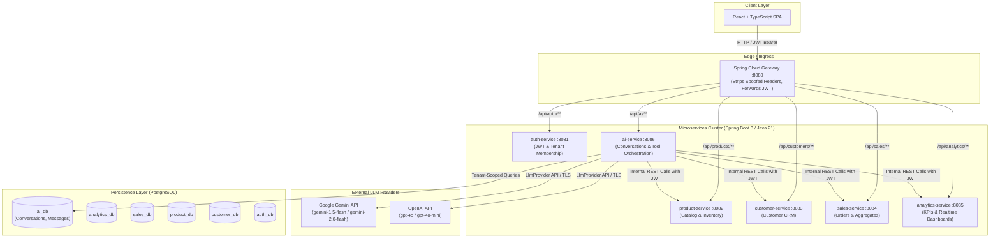

# AI Business Copilot — Architecture & Security Specification

## 1. Executive Summary & Strategic Objectives

The **AI Business Copilot** is an intelligent assistant integrated into the `ai-business-platform` SaaS ecosystem. It allows multi-tenant business owners, managers, and sellers to query, analyze, and extract insights from their operational business data using natural language.

Key design principles:
1. **Strict Multi-Tenant Isolation & Zero Client Trust:** Identity (`user_id`) and organizational scope (`tenant_id`) derive exclusively from cryptographically signed JWT tokens verified at the API Gateway and inside microservice boundaries. The frontend is never trusted for tenant context.
2. **Provider-Agnostic LLM Engine:** The platform is decoupled from any single AI vendor. It supports multiple LLM providers (e.g., Google Gemini, OpenAI, and local/mock providers for testing) via a clean abstraction layer with configurable retries, timeouts, and fallback policies.
3. **Defense in Depth & Safe Tool Execution:** The LLM is never granted raw database access or arbitrary query/code execution. When the user asks business questions, the LLM emits structured tool invocation requests. The AI Service validates the arguments, asserts tenant boundaries, calls existing microservice APIs (`analytics-service`, `sales-service`, `product-service`, `customer-service`) using the authenticated tenant's identity, and passes safe, bounded payloads back to the model.
4. **Resilience & Cost Governance:** Prompt size limitations, token caps, rate limiting, circuit breaking, and bounded tool execution depth prevent token exhaustion, infinite recursion, and denial-of-service vulnerabilities.

---

## 2. High-Level Architecture & Ecosystem Overview



---

## 3. Communication Patterns & Tenant Context Flow

### 3.1 Authentication & Header Sanitation
1. The user authenticates with `auth-service` via `/api/auth/login` or switches organization via `/api/auth/switch-tenant`.
2. A JWT is issued containing:
   - `sub`: User email
   - `user_id`: Numeric identifier (e.g. `1`)
   - `tenant_id`: UUID of the active organization (e.g. `11111111-1111-1111-1111-111111111111`)
   - `tenant_role`: Role within the tenant (`ADMIN`, `OWNER`, `MANAGER`, `SELLER`, `VIEWER`)
   - `roles`: Standard authorities (`ROLE_USER`, `ROLE_TENANT_ADMIN`, etc.)
3. `api-gateway` strips any client-supplied `X-Tenant-Id`, `X-Role`, or `X-User-Role` headers to prevent header injection attacks, forwarding only the signed `Authorization: Bearer <token>`.
4. In `ai-service`, Spring Security OAuth2 Resource Server validates the token signature via `NimbusJwtDecoder`. `TenantContextFilter` extracts `tenant_id` and registers it in `TenantContext` (`ThreadLocal<UUID>`). Any request to `/api/ai/**` missing a valid `tenant_id` is immediately rejected with HTTP 403 Forbidden.

### 3.2 Chat Request Lifecycle & Data Flow

```mermaid
sequenceDiagram
    autonumber
    actor User as User Browser
    participant Gateway as API Gateway (:8080)
    participant AI as ai-service (:8086)
    participant AIDB as ai_db (PostgreSQL)
    participant LLM as External LLM Provider
    participant Analytics as analytics-service (:8085)

    User->>Gateway: POST /api/ai/chat { conversationId?, message: "What are my total sales?" }
    Note over Gateway: Strips spoofable headers; forwards Authorization header
    Gateway->>AI: POST /api/ai/chat
    Note over AI: 1. Validate JWT, resolve tenantId & userId<br/>2. Retrieve or initialize AiConversation<br/>3. Verify ownership: tenantId == conv.tenantId
    AI->>AIDB: Persist user message in ai_messages
    AI->>LLM: Send Chat Completion Request (System Prompt + History + Tool Definitions)
    LLM-->>AI: Tool Call Required: getSalesSummary(from, to)
    Note over AI: Validate tool parameters & permission.<br/>Invoke downstream service with current tenant JWT.
    AI->>Analytics: GET /api/analytics/kpi?from=...&to=...
    Analytics-->>AI: 200 OK { totalRevenue: 15420.50, completedSalesCount: 42, ... }
    AI->>LLM: Return Tool Result { totalRevenue: 15420.50, ... }
    LLM-->>AI: Final Answer: "Your total revenue this month is $15,420.50 across 42 orders..."
    AI->>AIDB: Persist assistant message in ai_messages
    AI-->>Gateway: 200 OK { conversationId, response: "...", messageId, timestamp }
    Gateway-->>User: 200 OK
```

---

## 4. LLM Provider Abstraction

To ensure long-term architectural stability, independence from vendor price/API changes, and offline testability, the AI Service uses a clean abstraction hierarchy:

```
com.aibi.ai_service.provider
├── LlmProvider (interface)
│   ├── generateResponse(LlmRequest request): LlmResponse
│   └── getProviderName(): String
├── OpenAiProvider (implements LlmProvider)
├── GeminiProvider (implements LlmProvider)
├── MockLlmProvider (implements LlmProvider for CI / offline tests)
├── LlmProviderFactory
├── dto/
│   ├── LlmRequest
│   ├── LlmResponse
│   ├── LlmMessage (role: SYSTEM, USER, ASSISTANT, TOOL)
│   ├── LlmToolDefinition
│   ├── LlmToolCall
│   └── LlmToolResult
└── config/
    └── LlmProperties (ai.provider, ai.gemini.*, ai.openai.*, ai.timeout.*)
```

### 4.1 Safety & Configuration Guarantees
- **No Hardcoded Credentials:** Keys are sourced exclusively from environment variables (`GEMINI_API_KEY`, `OPENAI_API_KEY`).
- **Secret Redaction:** `LlmProperties` and loggers use strict masking; API keys and user prompts are never logged at `INFO` or higher.
- **Fail-Safe Fallback:** If an external LLM request times out (e.g. > 15s) or fails with a 5xx error, a controlled fallback response is returned to the client rather than an unhandled stack trace.
- **Pluggability:** Active provider selected via `ai.provider=gemini` or `ai.provider=openai` or `ai.provider=mock`.

---

## 5. Multi-Tenant Conversation Persistence (`ai_db`)

Conversations and their message histories are strictly partitioned by tenant and owner user.

### 5.1 Database Schema
```sql
-- Conversations Table
CREATE TABLE ai_conversations (
    id UUID PRIMARY KEY DEFAULT gen_random_uuid(),
    tenant_id UUID NOT NULL,
    user_id BIGINT NOT NULL,
    title VARCHAR(255) NOT NULL,
    created_at TIMESTAMP WITH TIME ZONE NOT NULL DEFAULT NOW(),
    updated_at TIMESTAMP WITH TIME ZONE NOT NULL DEFAULT NOW()
);

CREATE INDEX idx_ai_conversations_tenant_user ON ai_conversations (tenant_id, user_id, updated_at DESC);
CREATE INDEX idx_ai_conversations_tenant_id ON ai_conversations (tenant_id);

-- Messages Table
CREATE TABLE ai_messages (
    id UUID PRIMARY KEY DEFAULT gen_random_uuid(),
    conversation_id UUID NOT NULL REFERENCES ai_conversations(id) ON DELETE CASCADE,
    tenant_id UUID NOT NULL,
    role VARCHAR(20) NOT NULL CHECK (role IN ('USER', 'ASSISTANT', 'SYSTEM', 'TOOL')),
    content TEXT NOT NULL,
    tool_calls JSONB,
    created_at TIMESTAMP WITH TIME ZONE NOT NULL DEFAULT NOW()
);

CREATE INDEX idx_ai_messages_conv_created ON ai_messages (conversation_id, created_at ASC);
CREATE INDEX idx_ai_messages_tenant ON ai_messages (tenant_id);
```

### 5.2 Ownership & Access Verification
- Whenever retrieving, listing, or deleting a conversation:
  ```java
  Optional<AiConversation> findByIdAndTenantId(UUID id, UUID tenantId);
  ```
- If a conversation exists under Tenant B and a user from Tenant A requests `GET /api/ai/conversations/{id}`, the query returns empty, triggering a standard HTTP 404 (Resource Not Found), completely preventing ID enumeration and tenant leakage.
- If a user attempts to access a conversation owned by another user within the same tenant, authorization policies ensure only conversation owners or tenant administrators can inspect or delete history.

---

## 6. Business Data Integration & Tool Architecture

The LLM is given access to a curated catalog of read-only business analytical tools. Under no circumstance does the AI Service execute raw SQL or allow the LLM to write to database tables.

### 6.1 Tool Registry

| Tool Name | Underlying API Route | Target Service | Minimum Required Role | Purpose |
| :--- | :--- | :--- | :--- | :--- |
| `getSalesSummary` | `GET /api/analytics/kpi` | `analytics-service` | `VIEWER`, `SELLER` | Revenue, order count, average cart size |
| `getSalesTrends` | `GET /api/analytics/trends` | `analytics-service` | `VIEWER`, `SELLER` | Daily revenue & volume over period |
| `getTopSellingProducts` | `GET /api/analytics/top-products` | `analytics-service` | `VIEWER`, `SELLER` | Best-selling products by units & revenue |
| `getLowStockProducts` | `GET /api/analytics/low-stock` | `analytics-service` | `VIEWER`, `SELLER` | Products below inventory threshold |
| `getTopCustomers` | `GET /api/customers` | `customer-service` | `VIEWER`, `SELLER` | Active customers in the tenant |
| `compareRevenuePeriods` | `GET /api/analytics/kpi` (multi-range) | `analytics-service` | `VIEWER`, `SELLER` | Period-over-period financial comparison |

### 6.2 Tool Invocation Guardrails
1. **Tenant Immutability:** The LLM cannot provide or override `tenant_id`. Downstream service calls use `TenantContext.getRequiredTenantId()` and inject the user's authentic JWT or internal service token.
2. **Schema & Argument Validation:** All arguments (`from`, `to`, `limit`, `threshold`) are strictly validated against regexes and range bounds (e.g. `limit` capped at 25).
3. **Execution Recursion Cap:** Maximum 5 tool execution loops per single user interaction to eliminate runaway loops or quota draining.
4. **Result Sanitization & Size Limits:** Downstream JSON responses are truncated/summarized to at most 16 KB before passing into the LLM context to prevent context window blowing or injection via data poisoning.

---

## 7. Security Boundaries & Threat Modeling

| Threat Vector | Mitigation Strategy |
| :--- | :--- |
| **Cross-Tenant Data Leakage** | `tenant_id` resolved from verified JWT. All DB queries filtered by `tenant_id`. Internal HTTP calls forward authenticated tenant context. |
| **Prompt Injection (Jailbreaking)** | System prompt establishes strict assistant persona. The LLM cannot execute shell commands, SQL, or modify data. Structured outputs enforced. |
| **Denial of Service / Quota Burn** | In-memory token bucket rate limiting on `/api/ai/chat`. Max 10 user chat requests/minute per tenant user. Max conversation history limited to the last 20 messages. |
| **Downstream Service Outage** | Timeouts on `RestClient` (connect 3s, read 10s). Controlled HTTP 502/504 error mapping with human-friendly fallback messages. |
| **Credential & Secret Exposure** | API keys injected via environment variables. Masked in actuator `/env`. Excluded from client bundles. Zero git tracking. |

---

## 8. Implementation Plan & Phases

- **Phase 0:** Architecture audit and documentation (`docs/ai/AI_ARCHITECTURE.md`).
- **Phase 1:** Create `services/ai-service` (Spring Boot 3, Java 21, Flyway, PostgreSQL, Actuator, OpenAPI, port 8086, Gateway route).
- **Phase 2:** Implement LLM Provider Abstraction (`LlmProvider`, `GeminiProvider`, `OpenAiProvider`, `MockLlmProvider`, `LlmProviderFactory`).
- **Phase 3:** Tenant-aware conversation persistence (Entities, Repositories, Flyway migrations, indexes, isolation tests).
- **Phase 4:** REST Endpoints (`/api/ai/chat`, `/api/ai/conversations`, `/api/ai/conversations/{id}`).
- **Phase 5:** Business Data Tools integration (`analytics-service`, `product-service`, `customer-service`, `sales-service` clients, tool execution engine).
- **Phase 6:** Frontend chat interface in React + TypeScript (Chat drawer/page, markdown formatting, conversation management, error handling).
- **Phase 7:** Comprehensive automated test suite (Unit, Integration, Security, Mock LLM, Multi-tenant cross-boundary tests).
- **Phase 8:** Infrastructure updates (`docker-compose.yml`, `init-databases.sh`, `.env.example`, README).
