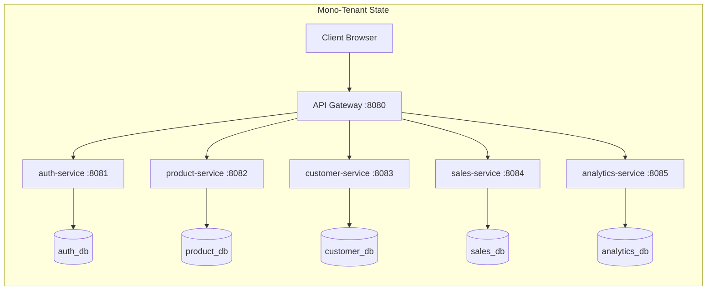
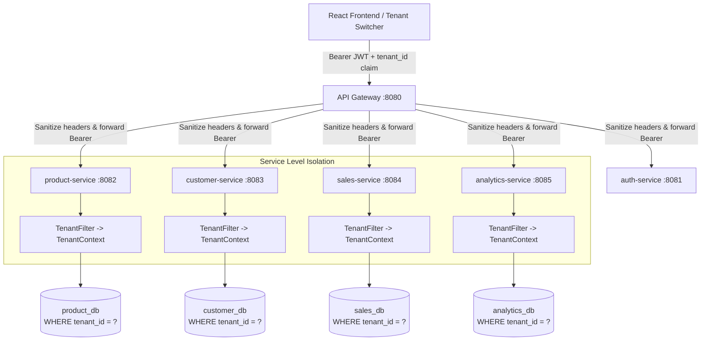

# Multi-Tenancy Architecture & Security Specification

## 1. Executive Summary & Strategic Objectives

The `ai-business-platform` is evolving from a single-tenant (global data model) microservices platform into a secure, production-grade Multi-Tenant Software-as-a-Service (SaaS) platform. Multiple independent business organizations (companies/tenants) will operate on shared cloud and database infrastructure while strictly maintaining complete data isolation, regulatory compliance, and operational reliability.

### Core Non-Negotiable Security Principles
1. **Zero Client Trust:** The frontend is never trusted for tenant identity. The active tenant identifier must strictly derive from a cryptographically signed, verified JWT claim matched against verified tenant membership.
2. **Defense in Depth (No Gateway-Only Isolation):** Every microservice must independently authenticate, validate, and enforce tenant isolation at its API layer, service layer, and database query layer.
3. **Fail-Closed on Missing Tenant Context:** Any request reaching a tenant-scoped business resource without a verified tenant context must immediately fail with an authentication/authorization refusal (HTTP 401/403).
4. **Complete Query Scoping:** Every business SQL query and persistence operation must be scoped by `tenant_id`. No unscoped queries are permitted.
5. **Cross-Tenant Relationship Impossibility:** Composite database constraints, service validations, and inter-service token propagations guarantee that resources belonging to Tenant A can never be linked to, reserved by, or aggregated into Tenant B.
6. **Isolated Asynchronous Operations:** Sagas, retries, stock reconciliations, and background jobs must explicitly track and enforce the tenant scope under which they were initiated.
7. **Cache & Secret Isolation:** Cache keys must be partitioned by tenant (`tenant:{tenantId}:...`), and secrets/tokens must never leak in logs or error traces.

---

## 2. Current Architecture vs. Target Multi-Tenant Architecture

### Current Mono-Tenant Architecture
- **Authentication:** Global `users` table in `auth-service`. Single-tier roles (`USER`, `ADMIN`).
- **JWT:** Contains `sub` (email) and `roles` (`ROLE_USER`, `ROLE_ADMIN`). No tenant dimension.
- **Microservices (`product-service`, `customer-service`, `sales-service`, `analytics-service`): All entities have global primary keys (`id`) and global unique constraints (e.g. `products.name`, `customers.email`, `sales.reference`).
- **Inter-service Calls:** `sales-service` and `analytics-service` propagate user authorization or an unscoped internal token (`InternalTokenService`).



### Proposed Multi-Tenant SaaS Architecture (Pooled Database with Discriminator Column)
- **Isolation Pattern:** Shared database per service, shared schema with mandatory `tenant_id UUID` discriminator columns, composite indexes, and composite uniqueness constraints. This provides the optimal balance of resource efficiency, horizontal scalability, unified Flyway migrations, and strict transactional isolation.
- **Tenant Management:** First-class `Tenant` and `Membership` entities in `auth-service`.
- **Tenant-Scoped RBAC:** Granular tenant roles (`OWNER`, `ADMIN`, `MANAGER`, `SELLER`, `VIEWER`), preserving platform-level `ROLE_ADMIN` for super-administrative actions.
- **Contextual Token Execution:** JWT contains cryptographically verified `tenant_id`, `tenant_slug`, and tenant authorities.
- **Tenant Context Propagation:** Request filters populate a thread-safe `TenantContext` per microservice; downstream `RestClient` interceptors seamlessly propagate verified identity and tenant headers.



---

## 3. Tenant and Membership Data Model

### Data Entities in `auth-service`

#### 1. Tenant (`tenants`)
| Column | Type | Constraints | Description |
|---|---|---|---|
| `id` | `UUID` | PRIMARY KEY | Immutable unique tenant identifier |
| `name` | `VARCHAR(100)` | NOT NULL | Human-readable company name |
| `slug` | `VARCHAR(100)` | NOT NULL, UNIQUE | Normalized URL-friendly identifier |
| `status` | `VARCHAR(20)` | NOT NULL DEFAULT 'ACTIVE' | Lifecycle state: `ACTIVE`, `SUSPENDED` |
| `created_at` | `TIMESTAMP` | NOT NULL DEFAULT NOW() | Creation timestamp |
| `updated_at` | `TIMESTAMP` | NULL | Last modification timestamp |

#### 2. Membership (`memberships`)
| Column | Type | Constraints | Description |
|---|---|---|---|
| `id` | `UUID` | PRIMARY KEY | Immutable membership identifier |
| `tenant_id` | `UUID` | NOT NULL, FK -> `tenants(id)` | Associated tenant |
| `user_id` | `BIGINT` | NOT NULL, FK -> `users(id)` | Associated user |
| `role` | `VARCHAR(20)` | NOT NULL | Tenant role: `OWNER`, `ADMIN`, `MANAGER`, `SELLER`, `VIEWER` |
| `status` | `VARCHAR(20)` | NOT NULL DEFAULT 'ACTIVE' | State: `ACTIVE`, `INVITED`, `SUSPENDED` |
| `created_at` | `TIMESTAMP` | NOT NULL DEFAULT NOW() | Association timestamp |
| `updated_at` | `TIMESTAMP` | NULL | Last role/status update timestamp |

**Integrity Constraints:**
- `CONSTRAINT uq_memberships_tenant_user UNIQUE (tenant_id, user_id)`: A user cannot have multiple memberships within the same tenant.
- Index on `idx_memberships_user_id (user_id)`: Fast retrieval of a user's company affiliations.
- Index on `idx_memberships_tenant_id (tenant_id)`: Fast listing of tenant members.

---

## 4. Tenant Role & Permission Matrix

We explicitly separate **Platform Administration** (`ROLE_PLATFORM_ADMIN` / legacy `ROLE_ADMIN`) from **Tenant Administration**:

| Permission / Action | Platform ADMIN | Tenant OWNER | Tenant ADMIN | Tenant MANAGER | Tenant SELLER | Tenant VIEWER |
|---|:---:|:---:|:---:|:---:|:---:|:---:|
| **Platform Maintenance & System Metrics** | **YES** | NO | NO | NO | NO | NO |
| **Transfer Tenant Ownership / Delete Tenant** | **YES** | **YES** | NO | NO | NO | NO |
| **Manage Tenant Members & Assign Roles** | NO | **YES** | **YES** | NO | NO | NO |
| **Manage Catalog (Create/Edit/Delete Products)**| NO | **YES** | **YES** | **YES** | NO | NO |
| **View Catalog & Stock Levels** | NO | **YES** | **YES** | **YES** | **YES** | **YES** |
| **Manage Customers (Create/Edit/Delete)** | NO | **YES** | **YES** | **YES** | **YES** | NO |
| **Create & Process Sales (Saga Trigger)** | NO | **YES** | **YES** | **YES** | **YES** | NO |
| **Cancel Sales / View Orders** | NO | **YES** | **YES** | **YES** | **YES** | **YES** |
| **View Tenant Analytics & KPIs** | NO | **YES** | **YES** | **YES** | NO | **YES** |

---

## 5. JWT Claim Architecture & Tenant Context

### JWT Token Claims
```json
{
  "sub": "user@example.com",
  "user_id": 42,
  "tenant_id": "a0000000-0000-0000-0000-000000000001",
  "tenant_slug": "acme-corp",
  "tenant_role": "OWNER",
  "roles": [
    "ROLE_TENANT_OWNER",
    "ROLE_USER"
  ],
  "iat": 1794326400,
  "exp": 1794412800
}
```

### Context Extraction & Thread Safety
Every microservice implements a shared tenant abstraction:
```java
public final class TenantContext {
    private static final ThreadLocal<UUID> CURRENT_TENANT = new ThreadLocal<>();

    public static void setTenantId(UUID tenantId) { CURRENT_TENANT.set(tenantId); }
    public static UUID getTenantId() { return CURRENT_TENANT.get(); }
    public static UUID getRequiredTenantId() {
        UUID id = CURRENT_TENANT.get();
        if (id == null) {
            throw new MissingTenantContextException("Opération refusée : Contexte locataire (tenant_id) absent.");
        }
        return id;
    }
    public static void clear() { CURRENT_TENANT.remove(); }
}
```
A servlet filter (`TenantContextFilter`) intercepts every incoming request:
1. Extracts the verified `Jwt` from Spring Security's `SecurityContextHolder`.
2. Reads the `tenant_id` claim and parses the `UUID`.
3. Sets `TenantContext.setTenantId(tenantUuid)`.
4. Executes the filter chain within a `try ... finally { TenantContext.clear(); }` block, guaranteeing no ThreadLocal leakage in servlet thread pools.

---

## 6. Database Migration & Legacy Data Strategy

### Deterministic Legacy Tenant Definition
To ensure reproducible migrations across development, testing, staging, and production without runtime cross-service dependencies:
- **Legacy Tenant ID:** `00000000-0000-0000-0000-000000000001` (Fixed deterministic UUID)
- **Legacy Tenant Name:** `Entreprise Initiale (Legacy Platform)`
- **Legacy Tenant Slug:** `default-company`
- **Legacy Tenant Status:** `ACTIVE`

### Migration Strategy Per Service

#### `auth-service` (V2 Migration)
1. Create `tenants` and `memberships` tables.
2. Insert the deterministic legacy tenant (`00000000-0000-0000-0000-000000000001`).
3. For all existing users in `users`, automatically generate an `ACTIVE` membership in the legacy tenant:
   - Users with role `ADMIN` receive `OWNER` membership.
   - Users with role `USER` receive `MANAGER` membership.
4. Verify that zero users exist without membership in the legacy tenant.

#### `product-service` (V4 Migration)
1. Add `tenant_id UUID` column to `products` (initially nullable).
2. Backfill: `UPDATE products SET tenant_id = '00000000-0000-0000-0000-000000000001' WHERE tenant_id IS NULL`.
3. Set `ALTER TABLE products ALTER COLUMN tenant_id SET NOT NULL`.
4. Drop old global constraint `ALTER TABLE products DROP CONSTRAINT IF EXISTS products_name_key`.
5. Add composite unique constraint: `ALTER TABLE products ADD CONSTRAINT uq_products_tenant_name UNIQUE (tenant_id, name)`.
6. Add `tenant_id UUID` column to `stock_reservations` and backfill.
7. Set `ALTER TABLE stock_reservations ALTER COLUMN tenant_id SET NOT NULL`.
8. Create composite indexes: `idx_products_tenant_category (tenant_id, category)` and `idx_stock_reservations_tenant (tenant_id, reservation_id)`.

#### `customer-service` (V2 Migration)
1. Add `tenant_id UUID` column to `customers` (initially nullable).
2. Backfill: `UPDATE customers SET tenant_id = '00000000-0000-0000-0000-000000000001' WHERE tenant_id IS NULL`.
3. Set `ALTER TABLE customers ALTER COLUMN tenant_id SET NOT NULL`.
4. Drop old global constraint `ALTER TABLE customers DROP CONSTRAINT IF EXISTS customers_email_key`.
5. Add composite unique constraint: `ALTER TABLE customers ADD CONSTRAINT uq_customers_tenant_email UNIQUE (tenant_id, email)`.
6. Create composite indexes: `idx_customers_tenant_name (tenant_id, last_name, first_name)` and `idx_customers_tenant_company (tenant_id, company)`.

#### `sales-service` (V3 Migration)
1. Add `tenant_id UUID` column to `sales`, `sale_items`, `sagas`, and `saga_events`.
2. Backfill all existing rows with `'00000000-0000-0000-0000-000000000001'`.
3. Enforce `SET NOT NULL` on `tenant_id` for all four tables.
4. Drop old global unique index on `sales (reference)`.
5. Create composite unique index: `CREATE UNIQUE INDEX idx_sales_tenant_reference ON sales (tenant_id, reference)`.
6. Create composite unique index: `CREATE UNIQUE INDEX idx_sagas_tenant_saga_id ON sagas (tenant_id, saga_id)`.
7. Create indexes on `(tenant_id, customer_id)`, `(tenant_id, status)`, and `(tenant_id, created_at)`.

#### `analytics-service` (V2 Migration)
1. Add `tenant_id UUID` column to `analytics_snapshots`.
2. Backfill existing snapshots with `'00000000-0000-0000-0000-000000000001'`.
3. Set `ALTER TABLE analytics_snapshots ALTER COLUMN tenant_id SET NOT NULL`.
4. Drop old single-column index on `snapshot_date`.
5. Create composite unique index: `CREATE UNIQUE INDEX uq_analytics_snapshots_tenant_date ON analytics_snapshots (tenant_id, snapshot_date)`.

---

## 7. Cross-Service Communication & Background Jobs

### Synchronous User-Initiated Calls
When `sales-service` calls `product-service` (e.g. check stock, create reservation) or `customer-service` (validate customer):
1. `RestClientConfig` forwards the caller's validated `Authorization: Bearer <JWT>` header containing `tenant_id`.
2. Downstream service extracts `tenant_id` and queries only within that tenant scope.
3. If Tenant A attempts to reference a customer or product from Tenant B, the downstream lookup returns 404. The sale creation is rejected immediately with an informative domain error.

### Asynchronous System Background Calls (Saga Recovery & Scheduled Tasks)
For background tasks executing without an active HTTP session (e.g., `SagaRecoveryWorker`, `StockReconciliationService`):
1. The persisted `Saga` record explicitly stores `tenant_id`.
2. The worker retrieves the saga with its `tenant_id`.
3. `InternalTokenService.getInternalServiceToken(UUID tenantId)` generates a system JWT containing:
   - `sub`: `"system-saga-recovery"`
   - `tenant_id`: `<saga.tenant_id>`
   - `roles`: `["ROLE_ADMIN", "ROLE_TENANT_OWNER"]`
4. The outgoing HTTP call executes with this tenant-scoped system token, ensuring downstream product release occurs strictly within the originating tenant!

---

## 8. Cache & Redis Partitioning Strategy

Every tenant-managed entity cached in Redis must incorporate the tenant identifier in its cache key namespace:
- Product cache: `tenant:{tenantId}:products:{productId}`
- Customer cache: `tenant:{tenantId}:customers:{customerId}`
- Stock reservation lock: `lock:tenant:{tenantId}:stock:{productId}`
- Idempotency key: `idempotency:tenant:{tenantId}:{key}`

Eviction policies and cache purges will target tenant-specific key patterns, ensuring that evicting a resource in Tenant A has zero side-effects on Tenant B.

---

## 9. Frontend Architecture: Onboarding & Tenant Switching

### Client State Management
- `AuthContext`: Tracks `user`, `activeTenant`, and `availableTenants`.
- `TOKEN_STORAGE_KEY` & `ACTIVE_TENANT_KEY`: Store the currently active authenticated session.
- **Tenant Switcher Component:** Located in the application Header, displaying the current company name with a dropdown to switch between authorized companies.
- **Atomic Cache Invalidation:** When switching tenants:
  1. Frontend calls `/api/auth/tenants/{tenantId}/switch`.
  2. Receives a new signed JWT scoped to the target tenant.
  3. React Query cache is completely cleared (`queryClient.clear()`) to avoid any flash of stale data.
  4. Application reloads all business data under the new tenant context.

---

## 10. Security Threat Modeling & Defense Mechanisms

| Threat Vector | Attack Scenario | Architectural Defense & Mitigation |
|---|---|---|
| **Header Injection / Spoofing** | Attacker injects `X-Tenant-ID: <target_tenant>` header. | API Gateway unconditionally strips client-supplied tenant headers. Backend microservices only derive tenant identity from the cryptographically verified JWT payload. |
| **Token Tampering** | Attacker edits `tenant_id` claim in JWT. | Microservices verify JWT signature using shared HMAC-SHA256 secret (`Keys.hmacShaKeyFor`). Tampered tokens fail verification (HTTP 401). |
| **Unauthorized Tenant Switch** | User calls `/switch` with a tenant ID where they have no membership. | `AuthService` queries `memberships` table for `(tenant_id, user_id, status = 'ACTIVE')`. Non-members receive HTTP 403. |
| **Cross-Tenant ID Enumeration (BOLA/IDOR)** | Tenant A requests `GET /api/customers/{id_of_tenant_b}`. | Query executes `WHERE id = :id AND tenant_id = :tenantId`. Returns HTTP 404 (or 403), completely hiding the existence of the other tenant's entity. |
| **Cross-Tenant Reference Hijacking** | Tenant A creates a sale specifying `customer_id` belonging to Tenant B. | Downstream `customerServiceClient` queries with Tenant A's token. Customer is not found; sale creation is aborted. |
| **Information Leakage in Logs** | Correlation IDs or debug traces print customer or tenant secrets. | Structured logging strictly records correlation IDs and sanitized tenant UUIDs without leaking PII, passwords, or JWT payloads. |

---

## 11. Rollback & Disaster Recovery Strategy

1. **Database Rollbacks:** Every Flyway versioned migration (`V2`, `V4`, etc.) has an accompanying documented SQL down-migration script in `docs/architecture/rollback/`.
2. **Backward Compatibility:** All existing data is seamlessly migrated to the legacy tenant (`00000000-0000-0000-0000-000000000001`). Existing users receive owner/manager memberships automatically, ensuring zero service disruption or data loss upon upgrade.
3. **Fail-Fast Monitoring:** Platform metrics (`tenant_isolation_violation_count`, `unauthorized_tenant_access_count`) alert immediately in Prometheus/Grafana if any request lacks a valid tenant context.

---

## 12. Phased Implementation Roadmap & Verification Status

| Phase | Scope | Status | Test Coverage |
|---|---|---|---|
| **Phase 0** | Architecture Specification & Design Doc | **COMPLETED** (`0ba13ea`) | N/A |
| **Phase 1** | Tenant & Membership Model, Onboarding, Switch, JWT Claims (`auth-service`) | **COMPLETED** (`6716cbc`) | 28/28 tests passing |
| **Phase 2** | API Gateway Header Stripping & Product Isolation (`api-gateway`, `product-service`) | **COMPLETED** (`502adfd`) | 15/15 + 67/67 tests passing |
| **Phase 3** | Customer & Sales Isolation, Sagas & Compensation Scoping (`customer-service`, `sales-service`) | **COMPLETED** (`aee95e3`, `b4e61a9`) | 45/45 + 131/131 tests passing |
| **Phase 4** | Analytics Service Scoping, Context Propagation & Redis Prefix Strategy (`analytics-service`) | **COMPLETED** (`a027751`) | 31/31 tests passing |
| **Phase 5** | Frontend Multi-Tenancy, Company Switcher, Cache Invalidation (`frontend`) | **COMPLETED** (`ac506ba`) | 31/31 tests passing + `npm run build` OK |
| **Phase 6** | End-to-End Regression Verification across all 6 microservices & Frontend | **COMPLETED** | **317 backend tests + 31 frontend tests (348 total, 0 failures)** |

